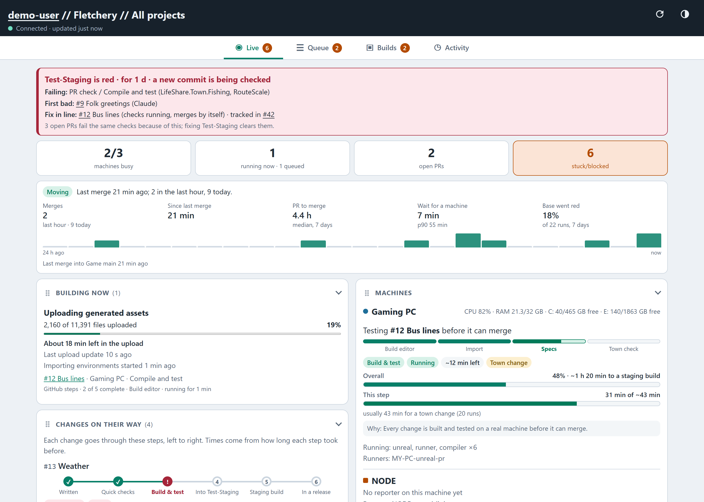
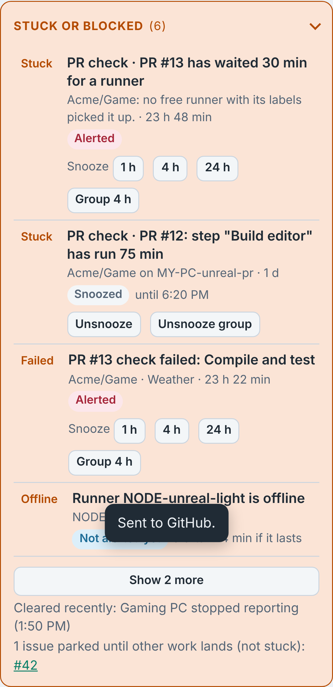
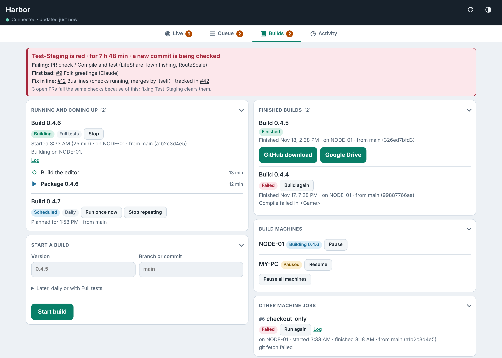
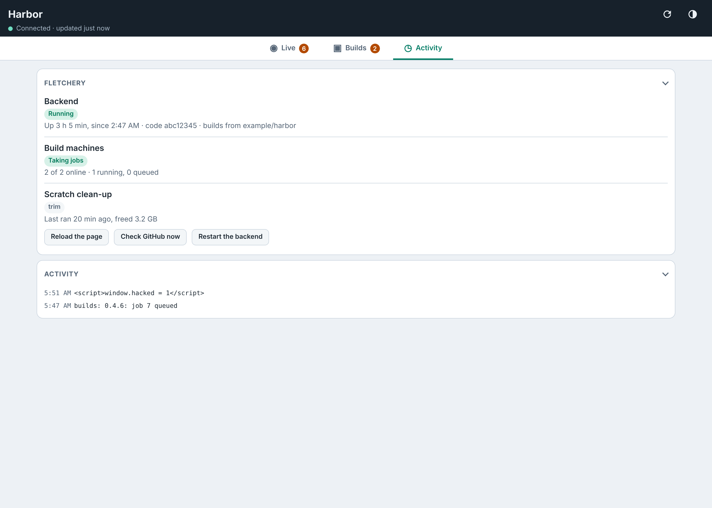
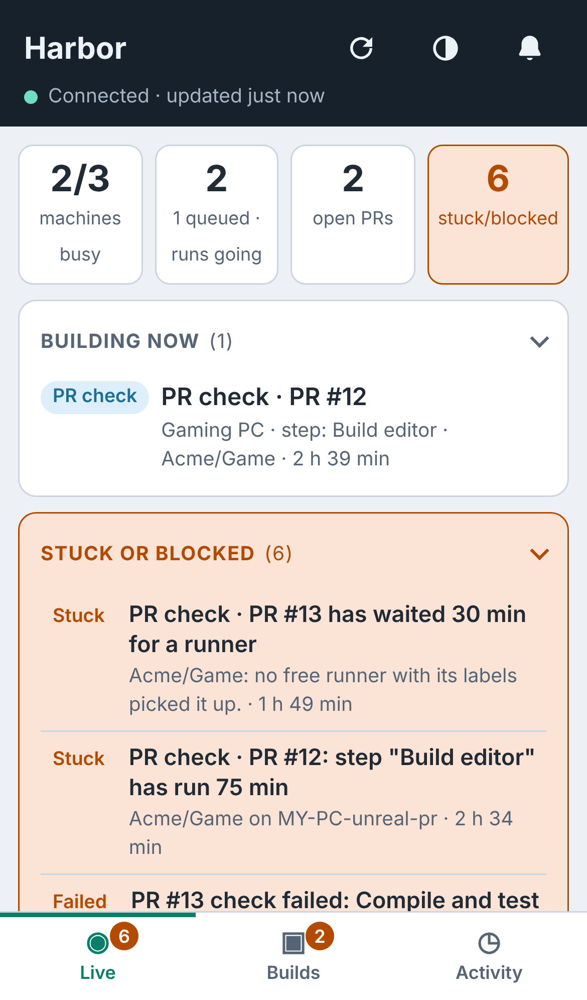
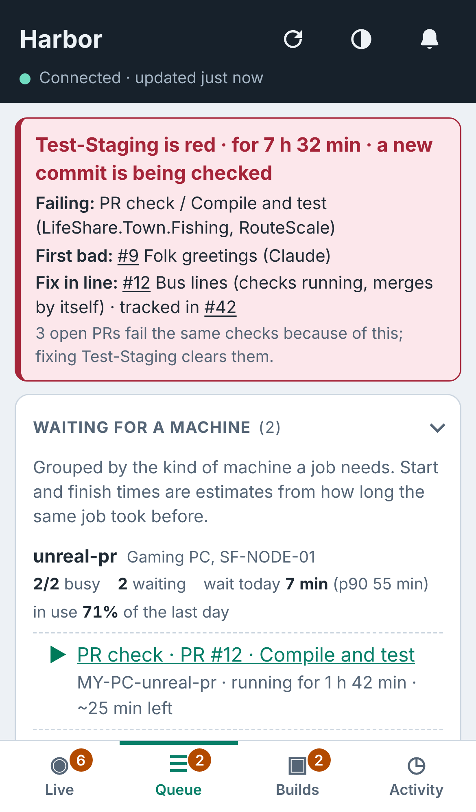
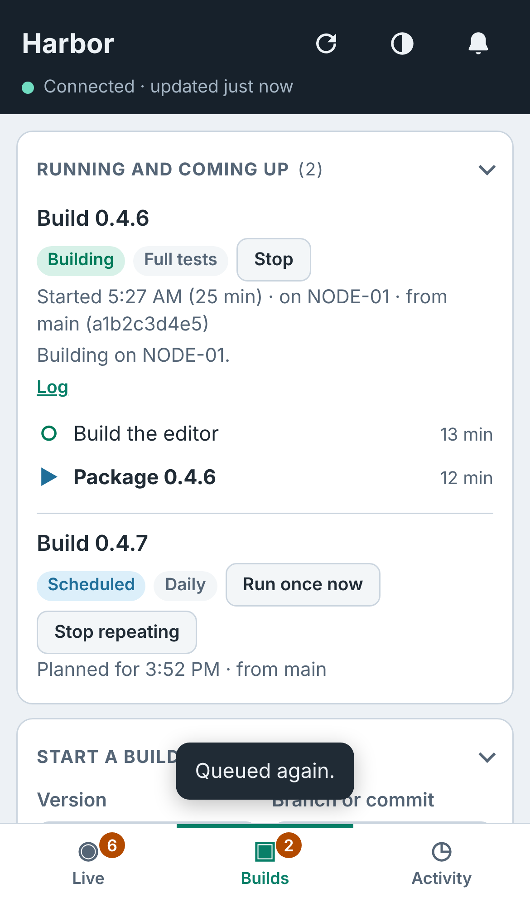
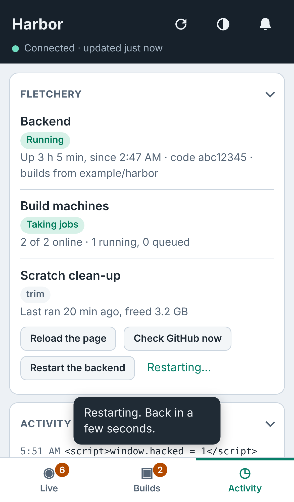
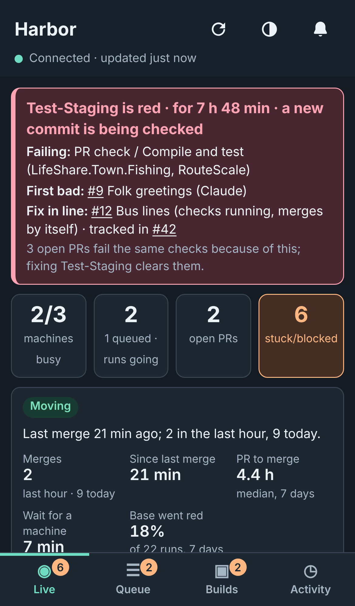

<p align="center">
  
</p>

<h1 align="center">Fletchery</h1>

<p align="center"><strong>One live view of all your development, on your PC and your phone.</strong></p>

Fletchery is a small Windows app that watches everything your projects have moving: GitHub Actions runs and the step
each one is on, your self-hosted runners, pull requests and their checks, issues, and what every build machine is
doing right now. It flags anything that stopped moving, and it starts, tracks and publishes your game builds. The same
page opens in a desktop window on the PC and as an app on your phone (over Tailscale, never the public internet).

The header shows your GitHub sign-in and selected project. Click the sign-in to switch the account Fletchery uses.
The open PR total follows the project selection. Building now shows each running check's current GitHub step,
elapsed time and completed steps, including checks that started before the most recent workflow runs.



<sub>Every screenshot here is the real page showing made-up data. See [where the pictures come from](#where-the-pictures-come-from).</sub>

**Jump to:** [What you see](#what-you-see) · [Controls](#controls) · [Install](#install) · [The profile](#the-profile) ·
[On your phone](#on-your-phone) · [Build machines](#build-machines) · [Session folders](#session-folders-scratch-retention) ·
[Safe by design](#safe-by-design) · [Something looks wrong](#something-looks-wrong) · [For developers](#for-developers)

## What you see

Four tabs, the same on the desktop and the phone. On the desktop the tabs sit at the top; on the phone they are a bar
at the bottom. Every card folds (tap its heading) and remembers that on the device, long lists show their first few
rows with **Show N more**, and an opened list scrolls and can be resized. **System / Light / Dark** is the button at
the top right.

| Tab | What it shows |
|---|---|
| **Live** | A **red banner** over every tab when a base branch (main, Test-Staging…) is red: which checks and tests fail, for how long, the first bad merge, the fix in line and how many PRs it holds red. **Why PRs are red** (each red PR's cause: its own bug, inherited from a red base branch, a machine problem, flaky, or cancelled; failures with the same cause, check and test are one problem, and only own bugs count as stuck), **Flow** at the top (is work moving: merges in the last hour and day, time since the last merge into each base branch, PR-to-merge time, wait for a machine, how often a base branch went red, and a plain verdict: Moving, Slow, Stopped or Idle), **Building now** (every build on every machine, whether Fletchery or a GitHub job started it), **Agents** (one row per Claude or Codex branch active in the last day: its PR or branch, what it waits on, when it last moved), **Stuck or blocked**, **Machines** (what each one is doing, CPU, RAM, disk), **Runners** (online, busy, idle, with the job and step), **GitHub Actions** runs with the current step, **Open pull requests** with their checks, and **Tasks and issues**. With several projects, chips under the numbers show one at a time. |
| **Queue** | **Waiting for a machine**: one block per kind of machine (runners with the same labels) with how many are busy, offline and waiting, today's wait (median and p90) and how much of the last day they were in use; then what runs (with time left) and what waits, in order, each with an estimated start and finish learned from how long the same job took before ("still being learned" until it knows). **Waiting for a machine's hold**, and **Cancelled today** with who or what cancelled each run: a press in Fletchery, a person named by GitHub, a newer run of the same check, or "outside Fletchery" when GitHub does not say |
| **Builds** | **Running and coming up**, **Start a build** (version and branch; later, daily or with the Full tests under *Later, daily or with Full tests*), **Finished builds** with their download links, and the **Build machines** |
| **Activity** | Health (up since, code version, GitHub reads, build machines), **Check GitHub now**, **Restart the backend**, and the log of everything done, including who did it ("from the window" or "from the phone") |

**Never stale.** The page asks every 5 s and shows how old each item is. If its data is older than 45 s, the PC can't
be reached, or GitHub has not been read for a few minutes, a red line at the top says so. **Stuck or blocked** names only what needs someone: a machine that stopped reporting, a hold whose process is gone
or whose CPU sat idle 10 minutes, a queue wait over 90 minutes, an Actions run waiting 20 minutes while a runner that
could take it is idle or none is online (waiting behind busy runners is a queue, not stuck), a step over 150 minutes, a
check or job over 3 hours, an offline runner, a run that keeps going after its pull request closed, a failed PR check
(the newest run of each check on the commit), a machine low on disk, and an issue or PR labelled `blocked`,
`needs-you`/`needs-alex` or `waiting-on…`. A check that was cancelled, or ended "No result" because its machine stayed
busy, shows as **Needs re-run** on its pull request, with a re-run button, and is not counted. A drive that has been
filling for the last hour or two shows when it will be full ("full in ~2.5 h"), and is flagged six hours ahead.

**Alerts, not alarms.** Each row in **Stuck or blocked** says whether it reached the phone. A rule per kind decides
how long a thing must last before it alerts (a silent machine or a lost GitHub feed 3 minutes, an offline runner or low
disk 5, a red base branch or an own bug at once), and how long it stays alerted after it goes, so one that flaps does
not alert again and again. Until then the row says **Not alerted yet · alerts in N min if it lasts**. Alerts that start
together for one project or machine arrive as one notification, and a quiet **Resolved** follows when they clear (the
last two hours of those are named under the card). Any alert, or its whole project or machine, can be snoozed for 1, 4
or 24 hours from its row: it stays listed, the phone is not told. Nothing merged for 3 hours while changes wait is an
alert too. Alerts and snoozes survive a restart.

<p></p>

**Cheap to run.** GitHub is read with ETags, so "nothing changed" costs nothing against GitHub's limit and no Actions
minutes. It reads every 15 s while anything runs and every 90 s when idle, and slows down by itself when the hourly
limit runs low. Runners are listed for each organisation and each repository, so repository-level runners show too; a
list GitHub refuses (no `admin:org` scope) is asked again hourly, and those runners still show through their jobs.

<p>
  
  
</p>

**Remembers.** What happened (merges, finished runs, job waits) is kept 90 days in `fletchery.db` in the state
folder, so the Flow numbers survive a restart. How it all fits together: [DESIGN.md](docs/DESIGN.md).

## Controls

The window and the phone have the same controls. Anything that stops work asks first.

| I want to… | Do this |
|---|---|
| Start a build | **Builds > Start a build**: a version (`0.4.5`) and a branch (empty = the base branch). **Later, daily or with Full tests** sets a time, repeats it daily, or runs the Full tests first |
| Stop a build | **Cancel** on a waiting build, **Stop** on a running one (the machine ends its processes within a minute), **Stop repeating** on a daily one |
| Build again | **Build again** on a failed or cancelled build |
| Start a waiting build now | **Start now** on a scheduled build (**Run once now** on a daily one) |
| Stop one machine taking builds | **Pause** on its row under Build machines; **Resume** undoes it. Running work finishes |
| Stop every machine taking builds | **Pause all machines** under Build machines |
| Stop a stuck GitHub Actions run | **Cancel run** on the runner or the run in Live |
| Run an Actions run again | **Re-run**, or **Re-run failed jobs** on a failed one |
| Read GitHub now | The refresh button at the top, or **Activity > Check GitHub now** |
| Restart Fletchery | **Activity > Restart the backend**. The supervisor brings it back in a few seconds with the newest installed code |
| Close the window but keep it running | Close it. Fletchery stays in the tray; right-click the tray icon to quit |

`workers.portal.controls: false` in the profile makes the phone read-only; the window always has the controls.

## Read API

`/api/v2/state` (the whole Live snapshot, `"schema": 2`, fields only ever added), `/api/v2/history` (merges, runs,
jobs, base-branch checks, disk readings and alerts from the last 90 days) and `/metrics` (Prometheus text, for Grafana)
answer the same callers as the page. [API.md](docs/API.md).

## Install

**You need:** Windows 10 or 11, [Python 3.10 or newer](https://www.python.org/downloads/) (tick *Add python.exe to
PATH*), [Git](https://git-scm.com/download/win) and the [GitHub CLI](https://cli.github.com/) signed in
(`gh auth login`). Microsoft Edge's WebView2, which draws the window, is already part of Windows 10 and 11.

1. **Get the code:** clone this repository, or use **Code → Download ZIP** and extract it.
2. **Write a profile** for your project ([The profile](#the-profile)); start from
   [`examples/Example.profile.json`](examples/Example.profile.json).
3. **Run the installer** in Windows PowerShell, in the repository folder:

   ```powershell
   powershell -NoProfile -ExecutionPolicy Bypass -File .\shell\Install-Fletchery.ps1 -Profile C:\path\Project.profile.json -AutoStart
   ```

   It builds `Fletchery.exe` with the compiler that comes with Windows, copies the app to
   `%LOCALAPPDATA%\Programs\Fletchery`, and adds **Fletchery** to the desktop and the Start menu. No administrator
   rights. `-AutoStart` registers one scheduled task, **Fletchery**, that starts the backend at sign-in and checks
   every 10 minutes that it still runs, with no window. The desktop window then only attaches to it.

4. **Open Fletchery.** To update later, pull this repository and run the installer again (the `-Profile` is
   remembered). The running backend notices the new code and restarts itself; quit the window from the tray and
   reopen it to get a new `Fletchery.exe`.

## The profile

A small JSON file. Only `name` and `repo` are required; everything else is optional and lives under `workers`.

```json
{
  "name": "Harbor",
  "repo": "your-org/harbor",
  "workers": {
    "baseBranch": "main",
    "stateDir": "",
    "dashboardPort": 8770,
    "portal": {"port": 8772, "hosts": ["your-pc.your-tailnet.ts.net"], "users": ["you@example.com"],
               "controls": true, "push": {"contact": "mailto:you@example.com"},
               "live": {"owners": ["your-org"], "activeDays": 21}},
    "machines": {"listen": "100.64.0.10:8771"},
    "builds": {"outDir": "D:\\Builds", "nodeLabels": ["unreal:5.8.4"], "publish": {"to": "github", "keep": 3}},
    "scratchRoots": ["D:\\scratch"]
  }
}
```

| Key (under `workers`) | What it does |
|---|---|
| `baseBranch` | What builds use when no branch is named |
| `stateDir` | Where Fletchery keeps its state, logs and builds (empty = `%LOCALAPPDATA%\Fletchery\<name>`) |
| `dashboardPort` | The desktop window's local port (`127.0.0.1` only) |
| `heavyLeaseFile` | The heavy-work lease file on this PC ([RESERVATIONS.md](docs/RESERVATIONS.md)); what holds it shows on Live |
| `portal` | The phone app and the Live feed: [PORTAL.md](docs/PORTAL.md). `live.owners` lists the GitHub organisations and users to watch; `live.names` gives machines friendly names; `live.diskFreeGb` flags a machine under that much free disk; `live.bases` (`{"owner/repo": ["main"]}`) watches branches no PR targets, `live.causes.machine` adds messages (regular expressions) that mean "the machine broke, not the code"; `live.fixLabels` and `live.redIssueLabels` name a project's base-fix PRs and base-red issues (defaults `tip-fix`, `tip-red` and similar); `live.projects` (`{"Game": ["owner/game", "owner/game-art"]}`) groups repositories into one project for the chips, Flow and alerts; `live.agents` (`[{"name": "Claude", "branches": ["claude/"], "logins": ["claude[bot]"]}]`) names the coding agents by branch prefix or PR author (default Claude and Codex); `live.alerts` changes a kind's rule in minutes, e.g. `{"disk": {"for": 10}, "flow": {"notify": false}, "runner": {"off": true}}` (kinds: feed, machine, runner, disk, base, check, stuck, label, flow; keys `for`, `keepFiring`, `notify`, `off`) |
| `machines` | The build machines' worker API on this PC's Tailscale address: [MACHINES.md](docs/MACHINES.md) |
| `builds` | Where finished builds go, extra labels a machine needs to take one, and publishing to GitHub releases or Google Drive |
| `scratch*` | Cleaning up session folders: [below](#session-folders-scratch-retention) |

`python -m fletchery config --profile <file>` prints the settings it would use. `python -m fletchery live --profile
<file>` does one GitHub read and prints the Live feed, a quick way to check the `gh` sign-in. A fuller example is
[`examples/LifeShare.profile.json`](examples/LifeShare.profile.json).

## On your phone

Add the page to your iPhone's Home Screen from Safari (no App Store) and it opens like an app, with notifications when
a build finishes or something gets stuck. It is reached over Tailscale only, answers only the Tailscale accounts you
list, and is never on the public internet. [Set it up](docs/PORTAL.md).

<p>
  
  
  
  
  
</p>

## Build machines

Every machine that builds (a test node, or this PC itself) runs a small worker, `fletchery/node_worker.py`, that
connects **out** to Fletchery over Tailscale, asks for a build, runs it, and sends the package back. Each machine also
runs `fletchery/reporter.py`, which tells the Live tab what it is doing (its runner job, a lease, a hand merge) with its
CPU, RAM and disk. Keys are per machine and revocable; a machine only runs its own built-in recipes. Setup, safety
and the API: [MACHINES.md](docs/MACHINES.md).

Finished builds land in `workers.builds.outDir`. With `publish` set, each one is also uploaded to a pre-release on the
project's repository (the newest `keep` are kept) or to Google Drive with `rclone` (`driveRemote`, `driveKeep`), and
the Builds tab links to it.

## Session folders (scratch retention)

People and agent sessions make their own worktrees, clones and packaged builds, and nothing else cleans those. Set
`workers.scratchRoots` (for example `["D:\\scratch"]`) and Fletchery looks at each folder directly under those roots
every hour, and at checkouts one level down inside a plain grouping folder (such as `wt\<name>`).

- **`trim` (the default):** once a git checkout has been idle `scratchTrimHours` (default 24) and no running process
  names it, its regenerable Unreal output is deleted: `Intermediate`, `Binaries`, `DerivedDataCache` and
  `Saved/Cooked`, `Saved/StagedBuilds` and `Saved/ShaderDebugInfo`, only where git ignores the folder and tracks
  nothing in it. Logs, screenshots and source stay.
- **`remove`:** a worktree idle `scratchRemoveDays` (default 7) that is clean, pushed, unlocked and holds no other
  checkout is retired in three steps, never one. A pass lists it in `scratch-plan.json`; a pass at least
  `scratchPlanHours` later (default 24), if its HEAD is unchanged, moves it with `git worktree move` into
  `lifeshare-quarantine` beside the root (`scratchQuarantineDir`), with a manifest; `scratchQuarantineDays` later
  (default 7) it is removed with `git worktree remove` (no `--force`, never prune), if still clean and pushed. Its
  branch stays and the newest `Saved/Logs` go to `scratchBackupDir` first.
- **`report`** lists only; **`off`** does nothing.

A clone with its own `.git` folder is only ever trimmed. A folder that is not a git checkout is never removed or moved
in any mode; one matching a `scratchDisposable` pattern such as `*-builds` is listed once idle for a person to move.
`scratchKeep` lists folder-name patterns that are never touched; `build-slots` and `lifeshare-quarantine` are always
kept, and Fletchery's own folders are always skipped. Receipts are in `scratch-retention.json`, including the idle
folders that still hold uncommitted or unpushed work, which only a person should decide on. `python
fletchery/scratch.py --root <folder> --mode remove` prints what a pass would do without changing anything. Build
machines run the same pass from `node_worker.py` ([MACHINES.md](docs/MACHINES.md#keeping-a-machines-disk-free)).

## Safe by design

- **The window is this PC only.** It is served on `127.0.0.1`, and every button needs a key only the page Fletchery
  served knows.
- **The phone is your tailnet only.** Tailscale Serve, never Funnel; only the Tailscale accounts in `users`, only the
  host names in `hosts`, and same-origin checks on every button. Folder paths on the PC are removed from what it shows.
- **Machines run recipes, not commands.** A build machine has its own list of what it agrees to run and its own
  read-only deploy key. Fletchery holds no machine's key, only its hash.
- **No hidden credentials.** Fletchery uses your `gh` sign-in. No token is kept in a profile, the repository or the
  log.
- **No windows.** Everything Fletchery starts runs hidden and below normal priority, so a game or a build always wins.

## Something looks wrong

See [TROUBLESHOOTING.md](docs/TROUBLESHOOTING.md). The quick ones:

| You see | What to do |
|---|---|
| A red line at the top of Live | It says why: the PC can't be reached, or GitHub has not answered. **Check GitHub now**; if GitHub keeps failing, run `gh auth status` on the PC |
| A runner you expect is missing | Its organisation or user must be in `live.owners`, or its repository pushed in the last `activeDays` |
| "Can't reach Fletchery's backend" | The supervisor restarts it by itself. If it stays, quit from the tray and reopen; the log is under **Open log folder** in the tray menu |
| The phone says "You are signed in to Tailscale as …" | Add that account to `workers.portal.users` and restart Fletchery |
| A machine shows Offline | Its worker or reporter stopped. Both are scheduled tasks on that machine that restart themselves within 10 minutes |

## For developers

| Folder | What |
|---|---|
| `fletchery/` | The backend (Python, standard library): `app.py` (the app and its controls), `devwatch.py` (the Live feed), `portal.py` (the page server for window and phone), `machines.py` and `node_worker.py` (build machines), `reporter.py`, `pipeline.py` (where each change is in the process, and step times), `presence.py` and `agent_status.py` (which coding agents are working: [docs/AGENT-PRESENCE.md](docs/AGENT-PRESENCE.md)), `store.py` (history in SQLite), `flow.py`, `rules.py` (base health, failure causes, queue estimates, disk forecast), `alerts.py`, `api.py` (the read API), `builds.py`, `publish.py`, `push.py`, `scratch.py` |
| `ui/portal/` | The page (no build step): `kit.js` (folding cards, long lists), `portal.js`, `live.js`, `portal.css`, `sw.js` |
| `shell/` | `Fletchery.exe` (C# + WebView2), the supervisor and the install script |
| `tools/` | The heavy-work reservation tool ([RESERVATIONS.md](docs/RESERVATIONS.md), [CANCELLATION.md](docs/CANCELLATION.md)) |
| `runner/` | A local GitHub Actions runner ([runner/README.md](runner/README.md)) |

Tests (no network):

```sh
python -m pytest fletchery/test_*.py          # or run each file with python
FLETCHERY_BROWSER=/path/to/chromium node ui/test-portal.cjs
```

`ui/test-portal.cjs` serves the page from a fixture (`ui/test-live-fixture.json`) and checks every tab at phone and
desktop size, light and dark, the controls, folding and long lists, offline use and read-only mode. Set
`FLETCHERY_PORTAL_SHOTS` to a folder to save its screenshots. GitHub's hosted checks (`.github/workflows/validate.yml`)
run only when started by hand. [Contributing](CONTRIBUTING.md).

### Where the pictures come from

The screenshots in `docs/images/fletchery/` are saved by `ui/test-portal.cjs` with `FLETCHERY_PORTAL_SHOTS` set: the
real page in headless Chromium, showing the made-up data in `ui/test-live-fixture.json`. Nothing in them comes from a
real project, machine, address or account.

---

Made by Stonefletcher Productions LLC. Fletchery grew out of BuildLane: the GitHub address still works under the old
name.
