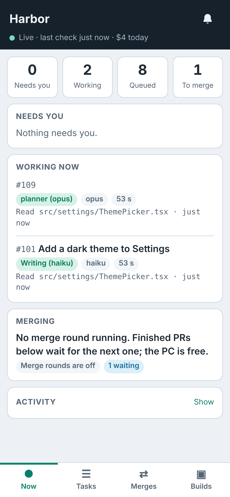

# Phone portal: follow Fletchery from your phone

The portal is a small web app served by Fletchery itself. On an iPhone you add it to the Home Screen from Safari and it
opens like an app: no App Store, no Apple developer account. It shows what needs you, the workers, the task queue, the
merge round, builds with their download links, the machines and the activity log, and it can send notifications.

It is **read-only**. There is no pause, no settings, no keys and no "add task" in it, and the server behind it has no
route that changes anything in Fletchery. Folder paths on the PC are removed from what it shows.

<p></p>

## How it is kept safe

- **Private network only.** The portal listens on `127.0.0.1` on the PC. [Tailscale Serve](https://tailscale.com/kb/1312/serve)
  puts it on your tailnet with a real HTTPS certificate. No router port is opened and nothing is on the public internet.
- **Only your Tailscale account.** Serve tells the portal which Tailscale account each request comes from (and removes
  that header from anything a client sends). The portal answers only the accounts in `users`. Tailscale Funnel (public)
  traffic and tagged devices carry no account, so they are refused. Do not turn on Funnel for this port; if someone
  does, the portal still refuses every request.
- **Only its own address.** Requests for any other host name are refused (DNS rebinding).
- **Nothing to steal on the phone.** There is no password or token in the page. Access is your Tailscale sign-in.
- **The dashboard stays where it was**, on `127.0.0.1:8770`, with all its controls. The portal is a separate port.

Why Tailscale and not a Cloudflare tunnel: the PC and the nodes are already on Tailscale (see [MACHINES.md](MACHINES.md)),
it needs no domain and no public address at all, and it tells the portal who is asking. A Cloudflare tunnel with
Access would also work but puts a public URL in front of the PC and needs a domain on Cloudflare.

## Set it up (about ten minutes, once)

**1. On the PC: turn the portal on.** Add this under `workers` in the project's profile, then restart Fletchery
(Settings > Restart, or it restarts itself between passes after an update):

```json
"portal": {
  "port": 8772,
  "hosts": ["YOUR-PC.YOUR-TAILNET.ts.net"],
  "users": ["the-account-you-sign-in-to-tailscale-with"],
  "push": {"contact": "mailto:you@example.com"}
}
```

- `hosts`: the PC's Tailscale name. `tailscale status --json | findstr DNSName` prints it (leave off the last dot).
- `users`: your Tailscale sign-in, as shown at the top of the Tailscale admin page. If it is wrong, the portal's
  refusal names the account you are signed in with, so you can copy it from there.
- `push` is optional; leave it out for no notifications. `contact` is required by Apple's push service: a `mailto:`
  address or an `https://` page. It is sent to the push service, not shown anywhere.

Check it on the PC itself: open `http://127.0.0.1:8772`.

**2. On the PC: share it on the tailnet.** In a terminal:

```powershell
tailscale serve --bg --https=443 http://127.0.0.1:8772
```

The first time, Tailscale prints a link to switch on HTTPS certificates for the tailnet; open it and allow it, then run
the command again. `tailscale serve status` shows it; `tailscale serve --https=443 http://127.0.0.1:8772 off` stops it.
If port 443 is already used by another Serve, use `--https=8443` and add `:8443` to the address below.

**3. On the iPhone.**

1. Install **Tailscale** from the App Store and sign in with the same account. Leave it connected.
2. In **Safari**, open `https://YOUR-PC.YOUR-TAILNET.ts.net`.
3. Tap **Share**, then **Add to Home Screen**. Open **Fletchery** from the Home Screen from now on.
4. For notifications (iOS 16.4 or newer): tap the bell, **Turn on notifications**, allow them, then **Send a test**.

Android and desktop browsers work the same way (Chrome: **Install app**).

## Notifications

With `push` in the profile the PC sends a notification when:

| Event | `events` name |
|---|---|
| a task needs you | `needs` |
| a merge round finishes | `merge` |
| a build finishes (once its download link is ready) or fails | `build` |
| a coding agent needs signing in again | `signin` |

`"push": {"contact": "...", "events": ["needs", "build"]}` limits them. Each message is encrypted for that one phone,
so Apple's push service relays it without being able to read it, and signed with a key made on the PC. Notifications
arrive even when Tailscale is off on the phone; opening the app needs Tailscale on.

Notifications need the Python package `cryptography` on the PC. It is usually there already (the Claude Agent SDK
brings it). If the bell says it is missing: `python -m pip install --user cryptography`, then restart Fletchery.

The key and the subscribed phones are kept in `portal-push.json` in the state folder. Delete that file to forget every
phone and make a new key.

## If something is wrong

| You see | Do this |
|---|---|
| "Can't reach the PC" | Tailscale is off on the phone, the PC is asleep, or Fletchery is not running |
| "You are signed in to Tailscale as …" | Add that account to `workers.portal.users`, restart Fletchery |
| "This address is not one of the portal's hosts" | Add the name in the address bar (no `https://`, no port) to `workers.portal.hosts` |
| "No Tailscale sign-in came with this request" | The device is tagged or the request came through Funnel; use a device signed in as you |
| The bell says to add it to the Home Screen | Notifications on iPhone only work from the Home Screen app, not from a Safari tab |
| "Connecting… Showing what it said …" | Normal for a few seconds after opening: the page opens from the copy saved on the phone, with the last status it had, while Tailscale connects |
| Fletchery's log says `portal: not started` | The line says why: a bad `portal` block, or port 8772 is in use (choose another `port`) |

## For developers

`fletchery/portal.py` (the server and `summary()`, which builds what the phone sees field by field), `fletchery/push.py`
(Web Push: RFC 8291 encryption, RFC 8292 VAPID), `ui/portal/` (the page, no inline code, strict CSP). Checks:
`python fletchery/test_portal.py` and `node ui/test-portal.cjs`. To look at it with made-up data:
`python fletchery demo --serve --profile <a profile with workers.portal>`.

## Live tab: every machine, runner, Actions run, PR and issue

The **Live** tab (first tab) shows everything happening in development, across every repository the PC's GitHub
sign-in can see and every machine that reports: what each machine is doing right now (PR check, hand merge, proof,
build, Claude coding), who queues for it, CPU/RAM/disk, the self-hosted runners and their jobs, Actions runs with the
current step, open pull requests with their checks, and open issues. **Stuck or blocked** at the top names anything that
stopped moving. Code: `fletchery/devwatch.py` (the feed), `fletchery/reporter.py` (each machine), `ui/portal/live.js`.

**One view on both.** The desktop Fletchery window opens on the same Live view (its **Live** menu item shows the
portal page from this PC), and the phone shows it as the first tab. When the coder agents and merge rounds are switched
off (`workers.enabled: false`), their screens leave both menus: what stays is Live, Building and Activity on the desktop,
Live and Builds on the phone. Several projects: chips under the numbers show one project at a time (remembered per device).

**Told when something sticks.** With notifications on, each new item in **Stuck or blocked** is sent once (event
`stuck`; a lost feed or a silent machine only after 3 minutes, so blips stay quiet). The phone app loads the newest page
from the PC whenever it answers within 4 seconds, and its saved copy only when the PC can't be reached, so an update
shows on the next open.

**Never stale.** The page asks every 5 s and every time shows how old each item is. If its data is older than 45 s,
the PC can't be reached, or GitHub has not been read for a few minutes, a red line at the top says so. The feed marks
as stuck: a machine that stopped reporting, a machine hold whose process is gone, a hold with the CPU idle 10 min, a
queue wait over 90 min, an Actions run unclaimed for 20 min, a step over 60 min, a check over 90 min, an offline
runner, a failed PR check, and any issue or PR with a blocked / needs-you label.

**Cost.** GitHub is read from the PC with ETags: a "nothing changed" answer (304) does not count against GitHub's
limit and uses no Actions minutes. It asks every 15 s while anything runs, every 90 s when idle, and slows down by
itself when the hourly limit runs low. New repositories appear on their own (every repository pushed in the last 21
days). Settings, all optional, under `workers.portal`:

```json
"live": {"owners": ["Stonefletcher-Productions-LLC", "ProjektPayne"], "exclude": [], "activeDays": 21,
         "fastSeconds": 15, "slowSeconds": 90, "names": {"ALEX-GAMING-PC": "Gaming PC"}}
```

`"live": false` turns it off. Listing an organisation's runners needs the `admin:org` scope on the PC's `gh` sign-in
(`gh auth refresh -h github.com -s admin:org`); without it, runners still show through their jobs.

**Each machine reports** with `reporter.py` (standard library, no window, read-only). It reads LaneGuard's lease and
queue, so every run that names itself with `LS_LANE_PURPOSE` ("PR check #2290", "Hand merge batch 7") shows by
name, plus any `<lease folder>\activity\*.json` file a script keeps fresh, and posts to the machines worker API
(`/v1/report`) with the machine's existing node key. Needs `workers.machines.listen` on the PC. Install once per
machine, no admin:

```powershell
# reporter.json beside the node worker's node.json:  {"nodeConfig": "<path to node.json>", "disks": ["C:\\", "E:\\"]}
pythonw <Fletchery>\fletchery\reporter.py install --config <path to reporter.json>
```

It adds a Task Scheduler entry that starts it every 5 minutes if it is not already running, so it comes back by
itself after a crash or reboot. `reporter.py once --config ...` prints one report without sending it.
