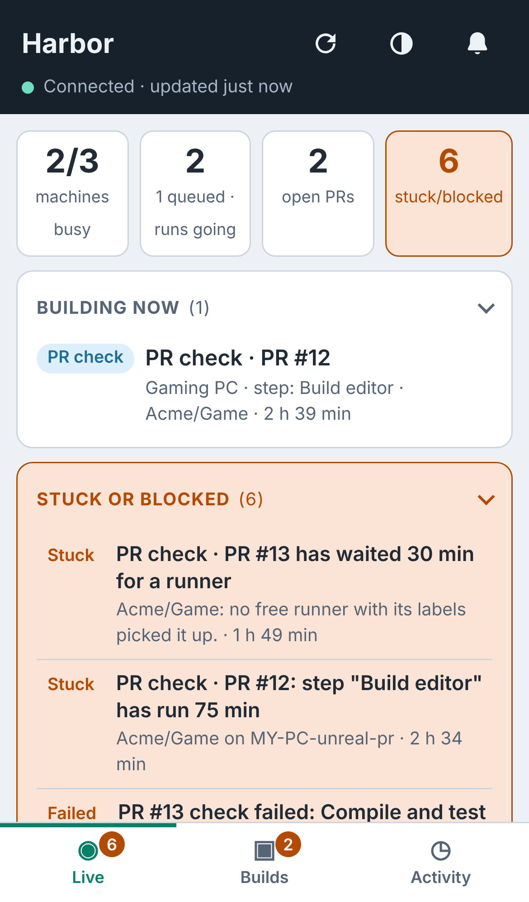

# Phone portal: Fletchery on your phone

The portal is the same page as the desktop window, served by Fletchery itself for your phone. On an iPhone you add it
to the Home Screen from Safari and it opens like an app: no App Store, no Apple developer account. It has the three
tabs (Live, Builds, Activity), the same controls as the window (start, stop and repeat builds, pause machines, cancel
or re-run Actions runs, restart the backend), and notifications when a build finishes or something gets stuck.

Every control asks first when it stops work, and every action is logged with the Tailscale account it came from
("from the phone (you@example.com)"). Folder paths on the PC are removed from what it shows. To make the phone
read-only, set `"controls": false` in `workers.portal`.

<p>
  </p>

## How it is kept safe

- **Private network only.** The portal listens on `127.0.0.1` on the PC. [Tailscale Serve](https://tailscale.com/kb/1312/serve)
  puts it on your tailnet with a real HTTPS certificate. No router port is opened and nothing is on the public internet.
- **Only your Tailscale account.** Serve tells the portal which Tailscale account each request comes from (and removes
  that header from anything a client sends). The portal answers only the accounts in `users`. Tailscale Funnel (public)
  traffic and tagged devices carry no account, so they are refused. Do not turn on Funnel for this port; if someone
  does, the portal still refuses every request.
- **Only its own address.** Requests for any other host name are refused (DNS rebinding).
- **Only from its own page.** A button press must come from the portal's own page (same origin), so another site
  open on the phone cannot press one.
- **Nothing to steal on the phone.** There is no password or token in the page. Access is your Tailscale sign-in.
- **The window stays where it was**, on `127.0.0.1:8770`. The portal is a separate port.

Why Tailscale and not a Cloudflare tunnel: the PC and the nodes are already on Tailscale (see [MACHINES.md](MACHINES.md)),
it needs no domain and no public address at all, and it tells the portal who is asking. A Cloudflare tunnel with
Access would also work but puts a public URL in front of the PC and needs a domain on Cloudflare.

## Set it up (about ten minutes, once)

**1. On the PC: turn the portal on.** Add this under `workers` in the project's profile, then restart Fletchery
(Activity > **Restart the backend**):

```json
"portal": {
  "port": 8772,
  "hosts": ["YOUR-PC.YOUR-TAILNET.ts.net"],
  "users": ["the-account-you-sign-in-to-tailscale-with"],
  "controls": true,
  "push": {"contact": "mailto:you@example.com"}
}
```

- `hosts`: the PC's Tailscale name. `tailscale status --json | findstr DNSName` prints it (leave off the last dot).
- `users`: your Tailscale sign-in, as shown at the top of the Tailscale admin page. If it is wrong, the portal's
  refusal names the account you are signed in with, so you can copy it from there.
- `push` is optional; leave it out for no notifications. `contact` is required by Apple's push service: a `mailto:`
  address or an `https://` page. It is sent to the push service, not shown anywhere.

Check it on the PC itself: open `http://127.0.0.1:8772`.

**2. On the PC: share it on the tailnet.** In a terminal:

```powershell
tailscale serve --bg --https=443 http://127.0.0.1:8772
```

The first time, Tailscale prints a link to switch on HTTPS certificates for the tailnet; open it and allow it, then run
the command again. `tailscale serve status` shows it; `tailscale serve --https=443 http://127.0.0.1:8772 off` stops it.
If port 443 is already used by another Serve, use `--https=8443` and add `:8443` to the address below.

**3. On the iPhone.**

1. Install **Tailscale** from the App Store and sign in with the same account. Leave it connected.
2. In **Safari**, open `https://YOUR-PC.YOUR-TAILNET.ts.net`.
3. Tap **Share**, then **Add to Home Screen**. Open **Fletchery** from the Home Screen from now on.
4. For notifications (iOS 16.4 or newer): tap the bell, **Turn on notifications**, allow them, then **Send a test**.

Android and desktop browsers work the same way (Chrome: **Install app**).

## Notifications

With `push` in the profile the PC sends a notification when:

| Event | `events` name |
|---|---|
| a build finishes (once its download link is ready) or fails | `build` |
| something new appears under **Stuck or blocked** (a lost feed or a silent machine only after 3 minutes) | `stuck` |

`"push": {"contact": "...", "events": ["build"]}` limits them. Each message is encrypted for that one phone,
so Apple's push service relays it without being able to read it, and signed with a key made on the PC. Notifications
arrive even when Tailscale is off on the phone; opening the app needs Tailscale on.

Notifications need the Python package `cryptography` on the PC. It is usually there already (the Claude Agent SDK
brings it). If the bell says it is missing: `python -m pip install --user cryptography`, then restart Fletchery.

The key and the subscribed phones are kept in `portal-push.json` in the state folder. Delete that file to forget every
phone and make a new key.

## If something is wrong

| You see | Do this |
|---|---|
| "Can't reach the PC" | Tailscale is off on the phone, the PC is asleep, or Fletchery is not running |
| "You are signed in to Tailscale as …" | Add that account to `workers.portal.users`, restart Fletchery |
| A button says "The phone is read-only" | `workers.portal.controls` is `false` in the profile |
| "This address is not one of the portal's hosts" | Add the name in the address bar (no `https://`, no port) to `workers.portal.hosts` |
| "No Tailscale sign-in came with this request" | The device is tagged or the request came through Funnel; use a device signed in as you |
| The bell says to add it to the Home Screen | Notifications on iPhone only work from the Home Screen app, not from a Safari tab |
| "Connecting… Showing what it said …" | Normal for a few seconds after opening: the page opens from the copy saved on the phone, with the last status it had, while Tailscale connects |
| Fletchery's log says `portal: not started` | The line says why: a bad `portal` block, or port 8772 is in use (choose another `port`) |

## The Live tab

The **Live** tab shows everything happening in development, across every repository the PC's GitHub sign-in can see
and every machine that reports: **Building now**, **Stuck or blocked**, what each machine is doing (PR check, hand
merge, build, a coding session) with CPU, RAM and disk, the self-hosted runners and their jobs, Actions runs with the
current step, open pull requests with their checks, and open issues. How it stays fresh and what counts as stuck is in
the [README](../README.md#what-you-see). Code: `fletchery/devwatch.py` (the feed), `fletchery/reporter.py` (each
machine), `ui/portal/live.js`.

Every card folds (tap its heading) and remembers that on the phone; long lists show a few rows and **Show N more**.
Several projects: chips under the numbers show one project at a time (remembered per device). The phone app loads the
newest page from the PC whenever it answers within 4 seconds, and its saved copy only when the PC can't be reached, so
an update shows on the next open.

Settings, all optional, under `workers.portal`:

```json
"live": {"owners": ["your-org", "your-user"], "exclude": [], "activeDays": 21,
         "fastSeconds": 15, "slowSeconds": 90, "names": {"NODE-01": "Test node"}, "diskFreeGb": 30}
```

`owners` are the organisations and users whose repositories are watched (every repository pushed in the last
`activeDays`); `exclude` drops some. `names` gives machines friendly names. `diskFreeGb` flags a machine with less free
disk. `agentIssues` names each repository's status issue for cloud agents and `agentActiveMinutes` (15) how
recent a heartbeat must be for the Agents card: see [AGENT-PRESENCE.md](AGENT-PRESENCE.md).
`pipeline` sets up the **Changes** card: `{"quick": ["^cheap", "lint"], "kinds": {"Town change": ["town", "road"]}}`
(regular expressions for the quick checks; words in a PR's title, labels or branch that make it a kind of change with
its own step times). `"live": false` turns it off.

**Changes** shows every open PR, and every PR merged in the last day, on the same six steps: Written, Quick checks,
Build & test, Into <base branch>, Staging build (the first push run on the base branch after the merge) and In a
release. Each has badges (step, state, time left, kind), an **Overall** bar from the first check to a green staging
build and a **This step** bar, both from how long those steps took before: the last 20 successful runs of each step,
per repository, kind of change and machine, kept in `<state dir>/step-times.json`. Until a step has run a few times
the card says it is still learning rather than guessing. A step past 1.5 times its usual time is flagged "Taking
longer than usual". On the **Machines** card, work Fletchery can tie to a change (its runner's PR or staging run, or
`#123` in a lease's name) is said in plain words ("Testing #12 Bus lines before it can merge") with the job's own
steps as a segmented bar and a line on why that step exists. Code: `fletchery/pipeline.py`. Runners are listed for each organisation and for each repository. Listing an
organisation's runners needs the `admin:org` scope on the PC's `gh` sign-in (`gh auth refresh -h github.com -s
admin:org`); without it they still show through their jobs, and the list is asked again every hour.

**Each machine reports** with `reporter.py` (standard library, no window, read-only). It reads LaneGuard's lease and
queue, so every run that names itself with `LS_LANE_PURPOSE` ("PR check #12", "Hand merge batch 7") shows by name,
plus any `<lease folder>\activity\*.json` file a script keeps fresh, and posts to the machines worker API
(`/v1/report`) with the machine's existing node key. Needs `workers.machines.listen` on the PC. Install once per
machine, no admin:

```powershell
# reporter.json beside the node worker's node.json:  {"nodeConfig": "<path to node.json>", "disks": ["C:\\", "E:\\"]}
pythonw <Fletchery>\fletchery\reporter.py install --config <path to reporter.json>
```

**Disk space.** When a disk guard writes `<lease folder>\disk.json` (LifeShare's `Tools/CI/DiskGuard.ps1`, every 10
minutes: `drive`, `freeGB`, `totalGB`, `state` ok/low/full, `warnGB`, `runnerStopped`, `holders`), the reporter (version
2) sends it too. The Machines card then shows that drive's free/total space, a warning under `warnGB` (50 GB by default),
and its biggest folders (by folder name, never the full path). Under `warnGB` it is listed in **Stuck or blocked** as
Low disk; with `state` full or a runner service stopped it is stuck as "PR runner offline: disk full". A disk.json not
rewritten for an hour is ignored. Without one, every drive's free space comes from the reporter itself, flagged under
`live.diskFreeGb` (30 GB).

It adds a Task Scheduler entry that starts it every 5 minutes if it is not already running, so it comes back by
itself after a crash or reboot. `reporter.py once --config ...` prints one report without sending it. Builds that
Fletchery itself runs show under **Building now** without a reporter.

## For developers

`fletchery/portal.py` (the server, `can_act()` which decides who may press a button, and `summary()`, which builds what
the phone sees field by field), `fletchery/push.py` (Web Push: RFC 8291 encryption, RFC 8292 VAPID), `ui/portal/` (the
page, no inline code, strict CSP). Checks: `python fletchery/test_portal.py` and `node ui/test-portal.cjs`.
