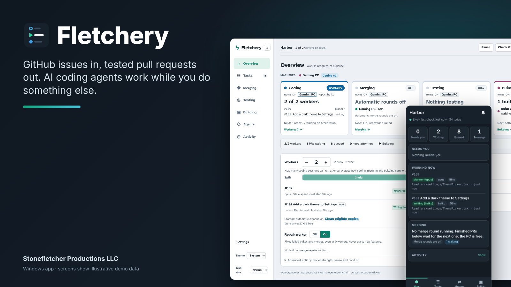

# Fletchery: marketing images

| File | Size | Use |
|---|---|---|
| `hero.png` | 1600×900 | Website, store page or post header |
| `social-preview.png` | 1280×640 | GitHub social preview (Settings → Social preview → Upload) and link cards |

Both are drawn from `banner.html` (open it in a browser, replace `CLS` on `<body>` with `hero` or `social`, and
capture at that size). The screens inside them are the README screenshots in `docs/images/fletchery/`: the real
dashboard and phone portal running the made-up "Harbor" demo project (`python -m fletchery demo --serve --fixture
harbor`). No real project, machine, address or account appears in them.

Credit line: Stonefletcher Productions LLC.
